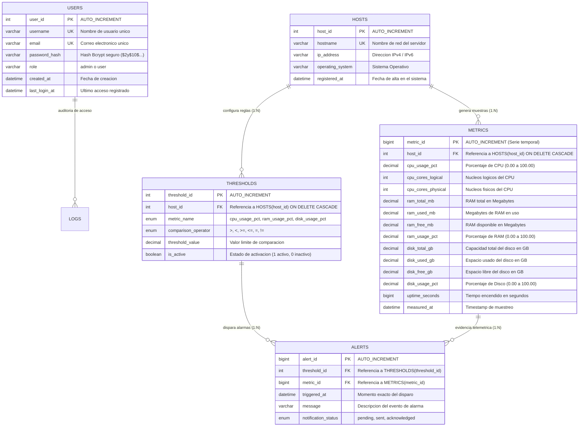

# Módulo de Base de Datos - Monitor Quintillizas

## Sistema de Gestión de Base de Datos Relacional (MySQL 8.0 / MariaDB / SQLite)
**Carrera:** Ingeniería en Sistemas Computacionales (5to Semestre)  
**Asignatura:** Taller de Base de Datos / Sistemas Distribuidos / Programación Web  
**Proyecto:** Monitor Quintillizas (Telemetría y Monitoreo de Infraestructura)  
**Repositorio Oficial:** [https://github.com/Monitor-Quintillizas/BD](https://github.com/Monitor-Quintillizas/BD)

---

## 1. Descripción del Módulo

El módulo de Base de Datos almacena y administra de forma centralizada:
1. **Usuarios y Operadores (`USERS`):** Cuentas con credenciales hasheadas con Bcrypt, roles de acceso (`admin` / `user`) y registro de actividad reciente.
2. **Inventario de Equipos y Servidores (`HOSTS`):** Nombres de host, direcciones IP y sistemas operativos supervisados.
3. **Telemetría de Series de Tiempo (`METRICS`):** Muestras históricas de uso de CPU (%), memoria RAM (MB y %), y almacenamiento en disco (%).
4. **Reglas de Umbrales (`THRESHOLDS`):** Condiciones lógicas y porcentajes límite parametrizados por equipo y métrica.
5. **Registro de Alertas (`ALERTS`):** Eventos de advertencia disparados en tiempo real cuando la telemetría excede las reglas.

---

## 2. Diagrama Entidad-Relación (Mermaid)



---

## 3. Diccionario de Datos Detallado

### Tabla: `USERS`
| Campo | Tipo | Nulo | Clave | Default | Descripción |
| :--- | :--- | :---: | :---: | :---: | :--- |
| `user_id` | `INT` | NO | **PK** | AUTO_INCREMENT | Identificador numérico único de la cuenta. |
| `username` | `VARCHAR(50)` | NO | **UK** | - | Nombre de usuario alfanumérico para login. |
| `email` | `VARCHAR(100)` | NO | **UK** | - | Correo institucional o de contacto del usuario. |
| `password_hash` | `VARCHAR(255)` | NO | - | - | Hash criptográfico generado mediante Bcrypt (`PASSWORD_BCRYPT`). |
| `role` | `VARCHAR(20)` | NO | - | `'user'` | Rol de seguridad en el sistema (`admin` o `user`). |
| `created_at` | `DATETIME` | NO | - | `CURRENT_TIMESTAMP` | Marca temporal del registro. |
| `last_login_at` | `DATETIME` | SÍ | - | `NULL` | Fecha y hora del último inicio de sesión exitoso. |

### Tabla: `HOSTS`
| Campo | Tipo | Nulo | Clave | Default | Descripción |
| :--- | :--- | :---: | :---: | :---: | :--- |
| `host_id` | `INT` | NO | **PK** | AUTO_INCREMENT | Identificador único del nodo o servidor. |
| `hostname` | `VARCHAR(100)` | NO | **UK** | - | Nombre de host en la red (ej. Servidor-Principal, Mi PC). |
| `ip_address` | `VARCHAR(45)` | NO | - | - | Dirección IP de red (soporta tanto IPv4 como IPv6). |
| `operating_system` | `VARCHAR(50)` | SÍ | - | `NULL` | Nombre y arquitectura del sistema operativo. |
| `registered_at` | `DATETIME` | NO | - | `CURRENT_TIMESTAMP` | Fecha de incorporación al inventario. |

### Tabla: `METRICS`
| Campo | Tipo | Nulo | Clave | Default | Descripción |
| :--- | :--- | :---: | :---: | :---: | :--- |
| `metric_id` | `BIGINT` | NO | **PK** | AUTO_INCREMENT | Identificador de alta cardinalidad para series temporales. |
| `host_id` | `INT` | NO | **FK** | - | Clave foránea referenciando `HOSTS(host_id)` con `ON DELETE CASCADE`. |
| `cpu_usage_pct` | `DECIMAL(5,2)` | NO | - | - | Carga del procesador expresada en porcentaje (0.00% a 100.00%). |
| `cpu_cores_logical` | `INT` | SÍ | - | `NULL` | Cantidad de hilos / procesadores lógicos reportados por el agente. |
| `cpu_cores_physical` | `INT` | SÍ | - | `NULL` | Cantidad de núcleos físicos reportados por el agente. |
| `ram_total_mb` | `DECIMAL(10,2)`| SÍ | - | `NULL` | Memoria RAM total instalada en Megabytes. |
| `ram_used_mb` | `DECIMAL(10,2)`| NO | - | - | Memoria física utilizada en Megabytes. |
| `ram_free_mb` | `DECIMAL(10,2)`| SÍ | - | `NULL` | Memoria RAM disponible en Megabytes. |
| `ram_usage_pct` | `DECIMAL(5,2)` | NO | - | - | Carga de memoria RAM en porcentaje (0.00% a 100.00%). |
| `disk_total_gb` | `DECIMAL(10,2)`| SÍ | - | `NULL` | Capacidad total del disco principal en Gigabytes. |
| `disk_used_gb` | `DECIMAL(10,2)`| SÍ | - | `NULL` | Espacio ocupado del disco principal en Gigabytes. |
| `disk_free_gb` | `DECIMAL(10,2)`| SÍ | - | `NULL` | Espacio disponible del disco principal en Gigabytes. |
| `disk_usage_pct`| `DECIMAL(5,2)` | NO | - | - | Uso del disco duro principal en porcentaje (0.00% a 100.00%). |
| `uptime_seconds`| `BIGINT` | SÍ | - | `NULL` | Tiempo de actividad del equipo en segundos desde el último arranque. |
| `measured_at` | `DATETIME` | NO | - | `CURRENT_TIMESTAMP` | Estampa de tiempo exacta de captura de la muestra. |

### Tabla: `THRESHOLDS`
| Campo | Tipo | Nulo | Clave | Default | Descripción |
| :--- | :--- | :---: | :---: | :---: | :--- |
| `threshold_id` | `INT` | NO | **PK** | AUTO_INCREMENT | Identificador único de la regla de umbral. |
| `host_id` | `INT` | NO | **FK** | - | Clave foránea referenciando `HOSTS(host_id)` con `ON DELETE CASCADE`. |
| `metric_name` | `ENUM` | NO | - | `'cpu_usage_pct'` | Métrica a evaluar (`cpu_usage_pct`, `ram_usage_pct`, `disk_usage_pct`). |
| `comparison_operator` | `ENUM` | NO | - | `'>'` | Operador relacional (`>`, `<`, `>=`, `<=`, `=`, `!=`). |
| `threshold_value`| `DECIMAL(5,2)` | NO | - | - | Porcentaje límite de disparo. |
| `is_active` | `BOOLEAN` | NO | - | `1` | Estado de la regla (1 activo, 0 inactivo). |

### Tabla: `ALERTS`
| Campo | Tipo | Nulo | Clave | Default | Descripción |
| :--- | :--- | :---: | :---: | :---: | :--- |
| `alert_id` | `BIGINT` | NO | **PK** | AUTO_INCREMENT | Identificador único del evento de advertencia. |
| `threshold_id` | `INT` | NO | **FK** | - | Umbral que originó el disparo (`THRESHOLDS`). |
| `metric_id` | `BIGINT` | NO | **FK** | - | Muestra exacta de telemetría que violó la regla (`METRICS`). |
| `triggered_at` | `DATETIME` | NO | - | `CURRENT_TIMESTAMP` | Momento exacto de generación de la alerta. |
| `message` | `VARCHAR(255)` | NO | - | - | Texto descriptivo del incidente para el operador. |
| `notification_status` | `ENUM` | NO | - | `'pending'` | Estado del ciclo de vida (`pending`, `sent`, `acknowledged`). |

---

## 4. Ejecución y Restauración del Script SQL

### Vía Docker Compose (Automático):
El archivo [`bd/init.sql`](file:///c:/Users/Adrian/OneDrive/Documentos/ITESI/Servicio%20Social/Monitor%20Quintillizas/bd/init.sql) se monta automáticamente en el directorio `/docker-entrypoint-initdb.d/` del contenedor MySQL para inicializar las tablas y datos de prueba al primer arranque.

### Vía Línea de Comandos (Manual):
```bash
mysql -u root -p monitor_team_db < init.sql
```

## Commits

Las issues de este proyecto están en `Monitor-Quintillizas/fronted`. Para que tus commits aparezcan en la issue, basta con escribir el número:

```bash
git commit -m "v1.2.0 #7"
```

El hook `.githooks/commit-msg` cambia `#7` por `Monitor-Quintillizas/fronted#7` al hacer el commit. Para activarlo, corre esto **una sola vez** en tu copia del repositorio (y otra vez si lo clonas en otra computadora):

```bash
git config core.hooksPath .githooks
```
